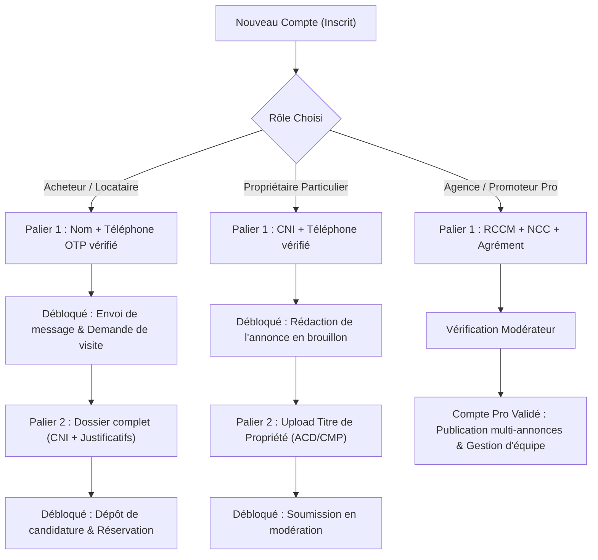

# 04 — Onboarding et Profils Utilisateurs de la Marketplace

> **Projet** : ImmOfika  
> **Type d'audit** : Phase 1 — Audit en lecture seule pour transformation en Marketplace Immobilière (Abidjan)  
> **Date** : 31 Octobre 2026  
> **Objectif** : Évaluer l'état actuel de chaque profil cible, cartographier les informations collectées vs nécessaires, et définir les exigences d'un profil vérifié et complet.

---

## 1. Matrice Globale des Profils : État Actuel vs Exigences Cibles

| Profil Cible | Statut Code Actuel | Collecté Actuellement | Informations Nécessaires Manquantes | Documents Requis & Circuit de Validation |
| :--- | :---: | :--- | :--- | :--- |
| **1. Visiteur (Non connecté)** | ✅ Existe | Aucune donnée. Consultation libre du catalogue. | Néant (doit pouvoir chercher et filtrer librement). | Aucun document. Incitation à créer un compte lors du favori/contact/visite. |
| **2. Acheteur / Locataire** | ⚠️ Partiel | Email, mot de passe (`authActions.ts:274`). Nom complet, téléphone, CNI (`/client/kyc`). | • Type de projet (Achat ou Location) • Communes & quartiers cibles à Abidjan (Cocody, Marcory, etc.) • Budget maximum (FCFA) • Nombre de pièces / typologie souhaitée • Canal de contact préféré (WhatsApp, Appel, Email) | **Dossier Locataire / Acquéreur** : • Pièce d'identité (CNI / Passeport) • 3 derniers bulletins de salaire ou justificatifs d'activité • Attestation d'emploi ou registre de commerce personnel. *Circuit* : Chiffré dans R2 privé (`private/dossiers/`), accessible uniquement à l'agence auprès de qui le candidat postule. |
| **3. Propriétaire Particulier (Bailleur)** | ⚠️ Partiel | Rôle `proprietaire` en DB, mais inscription impossible directement. Interface basique `/dashboard/bailleur`. | • Pièce d'identité officielle vérifiée • Adresse de résidence fiscale • Téléphone certifié par code OTP SMS • Nombre de biens en gestion propre | **Preuve de Propriété (Anti-Fraude)** : • Titre de propriété ou arrêté foncier (ACD, CMP, Lettre d'attribution) • Mandat de gestion si représentant familial. *Circuit* : Vérifié par l'équipe de modération avant publication de toute annonce (`statutModeration = 'valide'`). |
| **4. Agent Immobilier Indépendant** | 🔀 Décalé | Existe sous forme d'« Agent interne » de l'entreprise (`/admin/visites`, agenda iCal interne). | • Carte professionnelle ou attestation d'habilitation • Numéro de registre individuel ou patente commerciale • Zones et communes d'intervention à Abidjan • Photo professionnelle et biographie de présentation • Coordonnées directes (WhatsApp & Appel) | **Agrément & Identité Pro** : • Carte professionnelle d'agent immobilier • CNI du mandataire. *Circuit* : Vérification administrative avec badge officiel « Agent Vérifié ». |
| **5. Agence Immobilière (Compte Entreprise)** | ❌ Inexistant | Le rôle `agence` existe dans l'enum SQL, mais n'a aucun composant ni workflow dédié. Redirigé sur l'écran bailleur. | • Raison sociale de l'entreprise • Numéro RCCM (ex: `CI-ABJ-...`) • Compte Contribuable (NCC / DGI) • Adresse du siège social à Abidjan • Nom et identité du gérant légal • Gestion multi-collaborateurs (invitation d'agents de l'agence) | **Conformité Entreprise** : • Extrait du Registre de Commerce (RCCM) • Déclaration Fiscale d'Existence (DFE / NCC) • Carte d'identité du représentant légal. *Circuit* : Modération commerciale avant activation du compte agence. |
| **6. Promoteur Immobilier Agréé** | 🔀 Décalé | Actuellement, tout le code est pensé comme si l'application appartenait à **un seul** promoteur. | • Numéro d'agrément ministériel officiel de promoteur immobilier (MCLU) • Raison sociale et RCCM de la société de promotion • Programmes neufs et résidences en cours de réalisation • Échéanciers VEFA types | **Agrément Ministériel Officiel** : • Arrêté ministériel d'agrément en qualité de promoteur immobilier • Permis de construire et garanties d'achèvement (GFA). *Circuit* : Vérification stricte par la Direction Juridique avant octroi du badge « Promoteur Agréé ». |
| **7. Super Administrateur** | ✅ Existe | Accès total (`admin.general@immofika.ci`, `krsidoine7@gmail.com`). | Rôle racine technique et juridique opérationnel. | Authentification renforcée (MFA / 2FA à généraliser). |
| **8. Modérateur de Contenu** | ⚠️ Partiel | Écran `/admin/moderation` existant, mais restreint à l'approbation/rejet des annonces de base. | • File de modération des titres fonciers et preuves de propriété • Tableau de bord des signalements d'arnaques ou doublons • Outil de détection des numéros de démarcheurs récidivistes | Journal d'audit systématique de chaque décision de modération avec motif horodaté. |
| **9. Support / Gestionnaire de Litiges** | ⚠️ Partiel | Table `leads` et tickets Tally internes existants. | • Interface dédiée aux réclamations des utilisateurs • Historique des visites non honorées ou des signalements de biens non conformes | Conforme RGPD et loi n° 2013-450. |
| **10. Commercial / Account Manager** | ❌ Inexistant | Aucun rôle ni écran pour piloter les agences partenaires. | • Suivi des abonnements des agences et promoteurs • Gestion des options de mise en avant (packs annonces, sponsoring vitrine) | Facturation d'abonnements B2B. |

---

## 2. Analyse de la Complétion de Profil (« Profil Complet »)

### 2.1 État Actuel dans le Code
- Dans le code actuel, **aucune restriction ne bloque un utilisateur dont le profil est incomplet**.
- Un compte créé avec un simple e-mail peut réserver un bien (`reservation.ts:1-120`) sans même avoir renseigné son nom ou son numéro de téléphone réel.
- Le statut KYC (`profiles.kyc_status`) existe avec les valeurs `'none'`, `'pending'`, `'verified'` (`src/lib/db/schema.ts:49`), mais il n'est pas utilisé comme condition bloquante (gating) pour la prise de contact ou la réservation.

### 2.2 Règle Impérative de Gating pour la Marketplace
Afin d'éradiquer les arnaques, les fausses visites et les démarcheurs fantômes, le système doit introduire des paliers stricts de complétion :

---

## 3. Stockage Sécurisé & Circuit de Vérification des Pièces

1. **Règles de Stockage Cloudflare R2** :
   - 🚫 **Interdiction absolue** de stocker des pièces d'identité, attestations de salaire, titres fonciers ou contrats dans des dossiers ou buckets publics (pas d'accès direct via `R2_PUBLIC_URL`).
   - 🔒 **Arborescence Privée Dédiée** :
     - `private/kyc/{userId}/` : Pièce d'identité personnelle.
     - `private/dossiers/{dossierId}/` : Justificatifs de revenus et contrats.
     - `private/titres-propriete/{bienId}/` : ACD, attestations coutumières, extraits cadastraux.
   - ⏱️ **Accès éphémère** : Aucun streaming via le serveur web ; génération de liens signés S3 valables **5 minutes au maximum** (`getSignedUrl` avec expiration stricte), accordés uniquement après validation du droit de consultation (modérateur ou agence titulaire du mandat).

